<p align="center">
  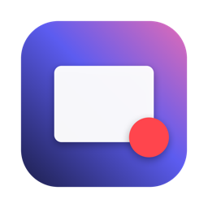
</p>

<h1 align="center">Framecast</h1>

<p align="center">
  <b>Hit record. Skip the edit.</b><br>
  A free, open-source screen recorder and editor for macOS, with Claude built in.
</p>

<p align="center">
  <a href="https://github.com/Rishit30G/framecast/releases/latest"></a>
</p>

<p align="center">
  
  
  
  <a href="LICENSE"></a>
</p>

<p align="center">
  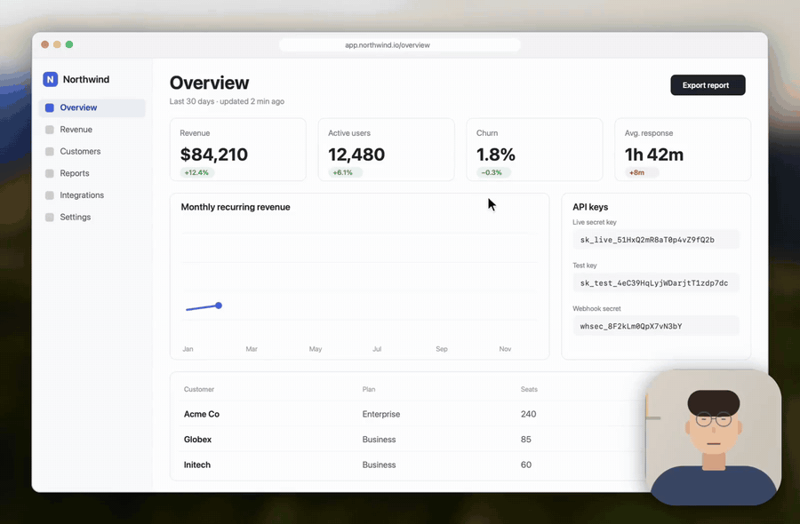
</p>

Framecast records your screen, camera and voice, then opens a real editor: auto zoom on your clicks, a camera bubble, captions, blur for secrets, music and a proper timeline. When you'd rather not edit at all, one click hands the recording to **Claude**, which edits it the way *you* like, from rules you write once in plain English.

Everything runs on your Mac. No account, no uploads, no watermark, no time limit.

## Contents

- [Features](#features)
- [Edit with Claude](#edit-with-claude)
- [Install](#install)
- [Build from source](#build-from-source)
- [Command-line tools](#command-line-tools)
- [How it's put together](#how-its-put-together)
- [Known limits](#known-limits)
- [Contributing](#contributing)
- [Licence](#licence)

## Features

<table>
  <tr>
    <td width="50%">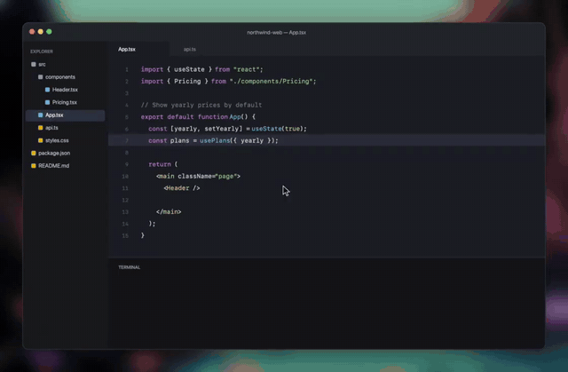<br><b>Auto zoom that follows your clicks</b><br>Every click is remembered while you record. Framecast glides in where the action is and back out. Place your own zooms too.</td>
    <td width="50%">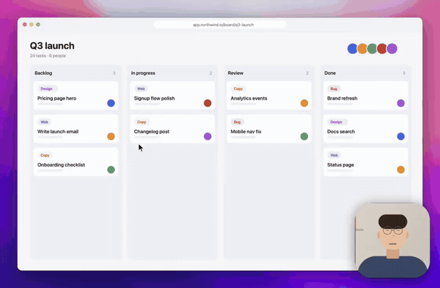<br><b>A camera that moves with the story</b><br>Nine positions, full screen while you talk, or hidden for a stretch. It glides between layouts.</td>
  </tr>
  <tr>
    <td>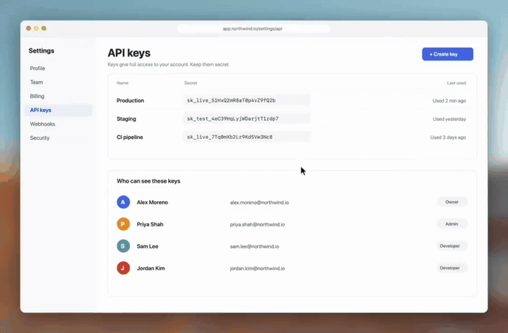<br><b>Blur secrets, point at what matters</b><br>Blur an API key, mark a row, or spotlight one button. Boxes stay pinned to the recording through every zoom.</td>
    <td>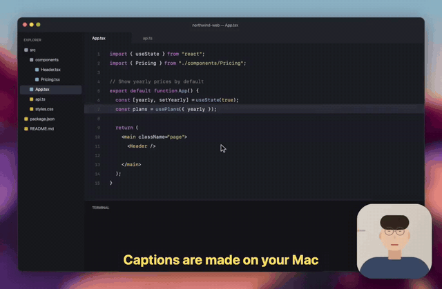<br><b>Captions made on your Mac</b><br>On-device transcription, your own font and colours, and .srt export.</td>
  </tr>
  <tr>
    <td>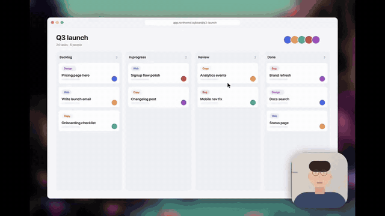<br><b>A frame worth looking at</b><br>macOS wallpapers, macOS solid colours, your own image or none. Background blur, padding, corners, shadow and a thin outline.</td>
    <td>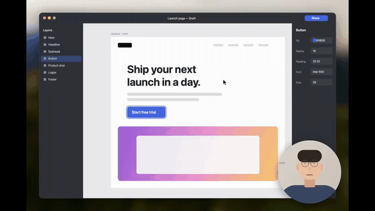<br><b>Any camera shape and size</b><br>Circle, rounded, square or wide, with size, corner radius, mirror and shadow.</td>
  </tr>
  <tr>
    <td>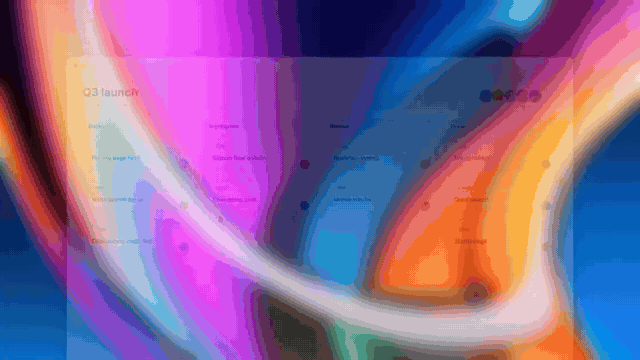<br><b>Ten ways in and out</b><br>Entry and exit animations on any cut: fade, fade up, four slides, zoom in and out, blur and pop.</td>
    <td>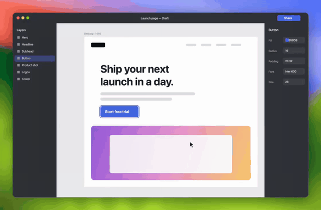<br><b>Titles, labels and logos</b><br>Text in your own font and colours, and images with rounded corners, each on its own track.</td>
  </tr>
  <tr>
    <td>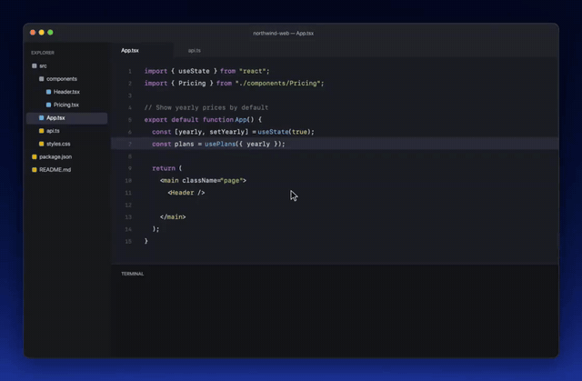<br><b>Show the shortcut you pressed</b><br>Shortcuts pressed while recording appear on screen for a moment.</td>
    <td align="center">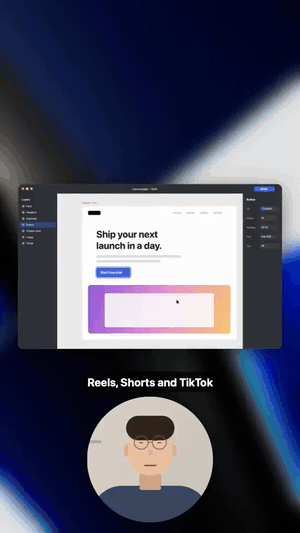<br><b>One recording, every shape</b><br>Auto, 16:9, 4:3, 1:1 and 9:16, plus crop. Camera and captions rearrange to fit.</td>
  </tr>
</table>

<p align="center">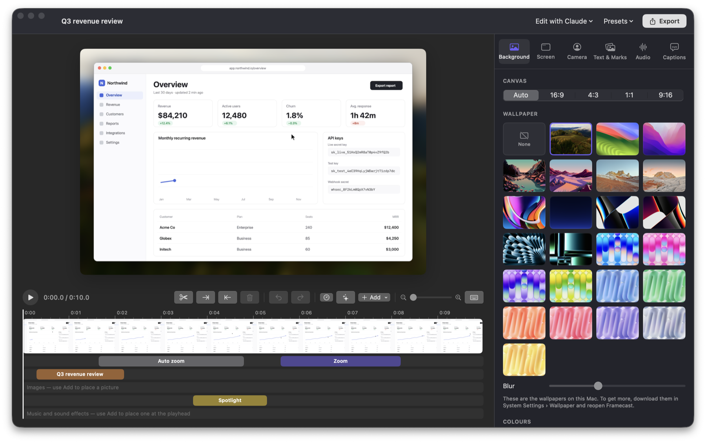</p>

<details>
<summary><b>Everything else</b></summary>

**Recording**
- Full screen, one window or any area
- Camera and microphone found automatically; system audio on or off
- Countdown, pause, resume, restart or discard
- <kbd>⌥⌘R</kbd> start/stop and <kbd>⌥⌘P</kbd> pause from any app
- Floating, resizable camera preview
- True-to-screen colour (captured and exported as sRGB)

**Timeline**
- Split, cut and trim; <kbd>Q</kbd> / <kbd>W</kbd> cut to the playhead
- Speed from 0.25× to 8× per clip
- Waveform that shows where you speak and where it's silent
- Pinch to zoom the timeline; undo and redo everything

**Audio**
- Music and sound effects on their own lanes; pick the exact part of a song
- Volume, fade in and fade out
- Record a voiceover over the video
- Voice clean-up (Apple's on-device sound isolation)

**Look and export**
- Presets: save a look and use it for every new recording
- MP4 (H.264 + AAC) at 4K, 1080p, 720p or original size, 30 or 60 fps
- A library of every recording

</details>

## Edit with Claude

Framecast ships with a [Claude](https://claude.ai) skill and a style file written in plain English. Your style file might say:

```markdown
## Fades
- None by default. Fade out and in only on long cuts.

## Camera
- Full screen when I'm only talking. Normal view when I'm showing something.

## Private things
- Always blur keys, emails and passwords.
```

In the editor, choose **Edit with Claude › Open in Claude**. The Claude desktop app opens on your recording with the request filled in; press Return. Claude reads your style, the transcript, the pauses, your clicks and the moments the screen sits still, then edits:

- removes pauses and keeps the last clean take of a repeated line
- zooms in where the cursor is working
- makes the camera full screen while you talk
- blurs keys, emails and passwords it finds on screen
- turns on captions and cleans up your voice

Edits appear in the open editor within a second, and <kbd>⌘Z</kbd> undoes them. The first edit saves a backup as `project.before-claude.json`. Everyone keeps their own style file, so each person's videos come out their way. Open it from **Edit with Claude › Open My Editing Style**.

The skill lives in [`Resources/skill`](Resources/skill) and is installed to `~/.claude/skills/framecast-editor` the first time you use the menu. It needs the [Claude desktop app](https://claude.ai/download) (Claude Code).

## Install

1. Download **Framecast.dmg** from the [latest release](https://github.com/Rishit30G/framecast/releases/latest).
2. Open it and drag **Framecast** into **Applications**.
3. Open Framecast. These builds aren't notarized yet, so macOS may block the first launch. If it does, open **System Settings › Privacy & Security** and click **Open Anyway**.
4. Allow **Screen & System Audio Recording**, **Camera** and **Microphone** when asked. **Input Monitoring** is only needed to show keyboard shortcuts.
5. Press <kbd>⌥⌘R</kbd> from any app to start recording.

**Requirements:** macOS 14 Sonoma or later on Apple silicon. On macOS 14 and 15, captions need Dictation turned on in System Settings.

## Build from source

You need Xcode 26 or later (the newer speech APIs need the macOS 26 SDK).

```bash
git clone https://github.com/Rishit30G/framecast.git
cd framecast
./build.sh
open build/Framecast.app
```

`build.sh` builds a release binary with Swift Package Manager and wraps it into `build/Framecast.app`. macOS ties screen-recording permission to an app's signature, so to stop it asking again after every rebuild, create a code-signing certificate named **Framecast Local Signing** in Keychain Access (Certificate Assistant › Create a Certificate, type *Code Signing*). `build.sh` uses it automatically, or set `FRAMECAST_SIGN_IDENTITY`.

## Command-line tools

The app binary doubles as a small toolkit, which is also how the Claude skill drives it:

| Command | What it does |
|---|---|
| `Framecast --info <folder>` | Facts about a recording as JSON: transcript, silences, still stretches, clicks, current look |
| `Framecast --apply <folder> <edits.json>` | Applies a list of edits (cut, removeSilences, zoom, camera, text, blur, highlight, captions, look…) |
| `Framecast --frame <folder> <seconds> <out.png>` | Renders one frame of the edited video |
| `Framecast --export <folder> [out.mp4] --res 1080p --fps 60` | Exports without opening the editor |
| `Framecast --selftest <folder>` | Renders a synthetic project through every export path |
| `Framecast --demos <folder>` | Renders the clips used in this README and on the website |

The edit format is documented in [`Resources/skill/SKILL.md`](Resources/skill/SKILL.md). Recordings live in `~/Movies/Framecast`, one folder each, with the edit stored in `project.json`.

## How it's put together

```
Sources/Framecast
├── Capture/      ScreenCaptureKit screen + system audio, camera and mic, pause clock, clicks and keys
├── Recorder/     The recorder bar, camera bubble, countdown and library
├── Editor/       Editor window, timeline and inspector (SwiftUI)
├── Render/       Composition, the Core Image frame renderer, zoom planning, export
├── ClaudeTools   --info / --apply / --frame / --export and the skill installer
├── Captions      On-device transcription
└── VoiceCleaner  Voice isolation for the microphone track
website/          The Next.js site (static export)
```

The preview and the export use the same renderer, so what you see in the editor is what you get in the file.

## Known limits

- Apple silicon only for now; Intel builds aren't produced yet.
- Releases aren't notarized yet (see Install).
- No cursor smoothing or cursor effects yet.
- No direct sharing or upload; Framecast makes files.

## Contributing

Bug reports, ideas and pull requests are welcome. Start with [CONTRIBUTING.md](CONTRIBUTING.md), and please follow the [code of conduct](CODE_OF_CONDUCT.md). Security issues: see [SECURITY.md](SECURITY.md).

## Licence

[MIT](LICENSE) © 2026 Rishit Gupta.

Made by [Rishit Gupta](https://x.com/rishit30g). Claude is a product of Anthropic; Framecast is an independent project.
